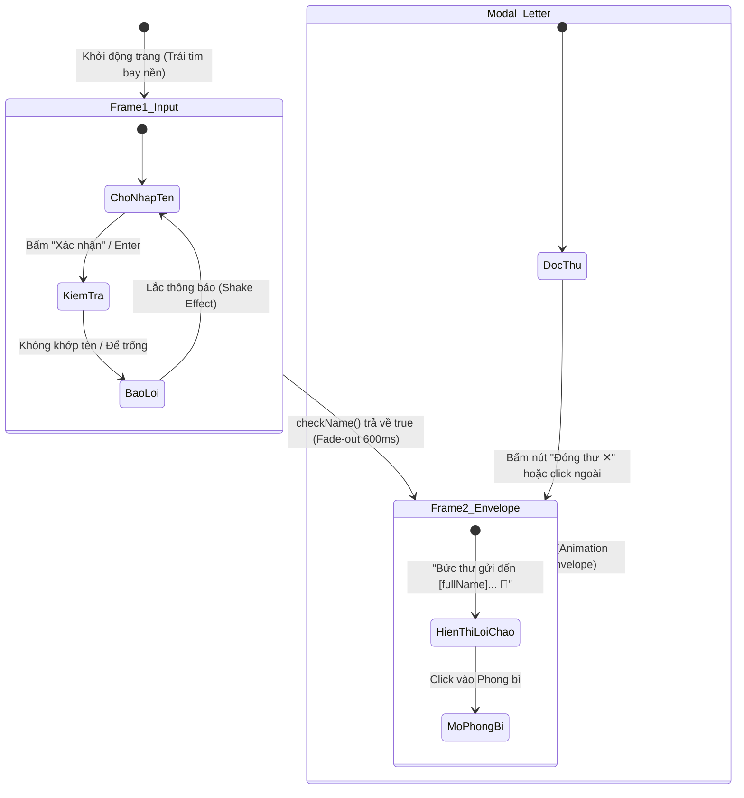

# 💌 Website Gửi Thư Chúc Mừng 20/10 — Personalized Letter Web App

> Trang web thiệp thư điện tử tương tác cao cấp dành tặng ngày Phụ Nữ Việt Nam 20/10. Hệ thống cho phép người nhận nhập tên (họ tên đầy đủ, tên gọi tắt hoặc biệt danh) để nhận bức thư được cá nhân hóa riêng biệt với hiệu ứng phong bì mở thư và trái tim bay lãng mạn.

---

## 📑 Mục lục
1. [Giới thiệu tổng quan](#-giới-thiệu-tổng-quan)
2. [Cấu trúc thư mục dự án](#-cấu-trúc-thư-mục-dự-án)
3. [Kiến trúc hệ thống & Luồng hoạt động](#-kiến-trúc-hệ-thống--luồng-hoạt-động)
4. [Mô hình dữ liệu (Data Architecture)](#-mô-hình-dữ-liệu-data-architecture)
5. [Thuật toán tìm kiếm 2 tầng (Priority Matching Engine)](#-thuật-toán-tìm-kiếm-2-tầng-priority-matching-engine)
6. [Chi tiết các tính năng chính](#-chi-tiết-các-tính-năng-chính)
7. [Thiết kế giao diện & Hiệu ứng (UI/UX Aesthetics)](#-thiết-kế-giao-diện--hiệu-ứng-uiux-aesthetics)
8. [Hướng dẫn cấu hình & Tùy biến thư](#-hướng-dẫn-cấu-hình--tùy-biến-thư)
9. [Hướng dẫn cài đặt & Triển khai](#-hướng-dẫn-cài-đặt--triển-khai)
10. [Công nghệ sử dụng](#-công-nghệ-sử-dụng)

---

## 🌸 Giới thiệu tổng quan

Website được xây dựng nhằm mang lại trải nghiệm tặng quà tinh tế, riêng tư và bất ngờ trong ngày 20/10:
- **Tính cá nhân hóa tuyệt đối**: Mỗi người bạn/người nhận sẽ có một bức thư với nội dung riêng biệt.
- **Trải nghiệm tương tác 3 giai đoạn**:
  1. *Frame 1 — Nhập tên*: Người nhận nhập họ tên hoặc tên gọi thân mật.
  2. *Frame 2 — Trao phong bì*: Hệ thống nhận diện đúng người và hiển thị phong bì kèm lời nhắn mời mở thư.
  3. *Modal — Đọc thư*: Phong bì bung mở hiệu ứng pop-up hiển thị bức thư đầy xúc cảm.

---

## 📂 Cấu trúc thư mục dự án

```text
my-letter-website/
│
├── index.html              # Cấu trúc giao diện ngữ nghĩa (HTML5)
├── style.css               # Hệ thống định kiểu, bảng màu pastel & animations (CSS3)
├── script.js               # Logic điều khiển, chuẩn hóa Unicode & thuật toán so khớp
├── README.md               # Tài liệu chi tiết kiến trúc và hướng dẫn sử dụng
│
├── letters/
│   └── letters-data.js     # Cơ sở dữ liệu danh sách người nhận và nội dung thư
│
└── images/
    ├── bg_floral.jpg       # Ảnh nền hoa nhã nhặn phủ lớp mờ pastel
    └── envelope.jpg        # Hình ảnh phong bì thư tương tác
```

---

## 🏛️ Kiến trúc hệ thống & Luồng hoạt động

Ứng dụng được thiết kế theo mô hình **Single Page Application (SPA) không phụ thuộc framework** (Vanilla JS), phân tách rạch ròi giữa tầng dữ liệu (`letters-data.js`), tầng điều hướng/logic (`script.js`), và tầng hiển thị (`index.html` + `style.css`).

### Sơ đồ luồng trạng thái (State Diagram)



---

## 🗄️ Mô hình dữ liệu (Data Architecture)

Dữ liệu thư được quản lý tập trung trong file [`letters/letters-data.js`](file:///Users/Apple/Documents/my-letter-website/letters/letters-data.js) dưới biến toàn cục `window.lettersData`.

### Cấu trúc một bản ghi (Record Schema):

```javascript
window.lettersData = {
  "UniqueKeyID": {
    fullName: "Họ và tên đầy đủ", // Chuỗi định danh hiển thị trên tiêu đề & lời chào
    aliases: [                    // Danh sách tên gọi tắt, tên lót, biệt danh, không dấu
      "họ và tên đầy đủ",
      "tên lót + tên",
      "tên gọi",
      "biệt danh"
    ],
    type: "text",                 // Định dạng thư: "text" hoặc "image" (thư tay)
    content: `Nội dung thư...`,    // Nội dung dạng văn bản (nếu type === "text")
    src: "images/thu_tay.jpg"     // Đường dẫn ảnh thư tay (nếu type === "image")
  }
};
```

### Ưu điểm của mô hình:
- **Tách biệt dữ liệu và mã nguồn**: Khi cần thêm/bớt người nhận hoặc chỉnh sửa lời chúc, chỉ cần sửa [`letters-data.js`](file:///Users/Apple/Documents/my-letter-website/letters/letters-data.js) mà không cần can thiệp logic ở [`script.js`](file:///Users/Apple/Documents/my-letter-website/script.js).
- **Hỗ trợ đa định dạng thư**: Cho phép viết thư dạng văn bản tự do (giữ nguyên ngắt dòng với thẻ `<pre>`) hoặc gửi file ảnh thư tay viết scan.

---

## ⚡ Thuật toán tìm kiếm 2 tầng (Priority Matching Engine)

Một trong những vấn đề phổ biến nhất của các web gửi thư là:
1. Người dùng nhập thiếu họ (chỉ nhập tên như *"Ý"* hoặc *"Như Ý"*).
2. Người dùng nhập không dấu (*"nhu y"*), viết hoa (*"NHƯ Ý"*).
3. **Trùng tên:** Có 2 người cùng tên *"Như Ý"* (ví dụ: *Tiêu Bùi Như Ý* và *Nguyễn Như Ý*).

Hệ sinh thái tìm kiếm trong [`script.js`](file:///Users/Apple/Documents/my-letter-website/script.js) giải quyết triệt để vấn đề này qua **Cơ chế 2 tầng ưu tiên**:

### 1. Hàm chuẩn hóa chuỗi `normalizeStr(str)`
- Sử dụng chuẩn phân rã ký tự Unicode: `normalize("NFD")`.
- Loại bỏ toàn bộ dấu tổ hợp tiếng Việt: `replace(/[\u0300-\u036f]/g, "")`.
- Chuyển ký tự chữ `đ/Đ` thành `d`.
- Chuyển toàn bộ về chữ thường (`toLowerCase()`).
- Loại bỏ ký tự đặc biệt, dấu câu và thu gọn khoảng trắng thừa: `replace(/\s+/g, " ")`.

### 2. Hai tầng đối soát ưu tiên (Priority Levels)

```javascript
function checkName(inputValue) {
  const normInput = normalizeStr(inputValue);
  if (!normInput) return false;

  const list = Object.values(window.lettersData);

  // ── TẦNG 1: Ưu tiên 1 (Exact Match 100% Họ và Tên) ──
  for (const item of list) {
    if (normalizeStr(item.fullName) === normInput) {
      detectedName = item.fullName;
      selectedLetter = item;
      return true; // Dừng ngay, lấy đúng bức thư người đó
    }
  }

  // ── TẦNG 2: Ưu tiên 2 (Alias Match — Tên gọi tắt / Tên lót / Biệt danh) ──
  for (const item of list) {
    if (Array.isArray(item.aliases)) {
      const isMatch = item.aliases.some(a => normalizeStr(a) === normInput);
      if (isMatch) {
        detectedName = item.fullName;
        selectedLetter = item;
        return true;
      }
    }
  }

  return false;
}
```

### Bảng minh họa kịch bản so khớp:

| Giá trị người dùng nhập | Tầng khớp | Bức thư nhận được | Giải thích |
| :--- | :---: | :--- | :--- |
| `Tiêu Bùi Như Ý` | **Tầng 1** | Tiêu Bùi Như Ý | Khớp chính xác 100% `fullName` |
| `tieu bui nhu y` | **Tầng 1** | Tiêu Bùi Như Ý | Khớp sau chuẩn hóa bỏ dấu & chữ thường |
| `Nguyễn Như Ý` | **Tầng 1** | Nguyễn Như Ý | Khớp chính xác người trùng tên nhưng khác họ |
| `Như Ý` hoặc `Ý` | **Tầng 2** | Tiêu Bùi Như Ý | Không khớp tầng 1, khớp alias trong danh sách |
| `admin` hoặc `khanh` | **Tầng 2** | Khánh (Admin) | Khớp alias của tài khoản quản trị |
| `Vô danh 123` | *Không khớp* | Báo lỗi rung thẻ | Không tìm thấy trong cả 2 tầng |

---

## 🎯 Chi tiết các tính năng chính

1. **Nhận diện danh tính tự động (Smart Name Detection)**:
   - Tự động bỏ qua lỗi viết hoa, gõ thiếu dấu tiếng Việt, khoảng trắng thừa.
   - Gán họ tên chuẩn chỉnh có dấu vào biến `detectedName` để chào đón lịch sự.
2. **Hiệu ứng chuyển cảnh mượt mà (Crossfade Transition)**:
   - Frame 1 fade out mượt mà trong 600ms đồng thời thu nhỏ tỉ lệ (scale 0.95).
   - Frame 2 trượt nhẹ từ dưới lên (translateY: 20px → 0px) tạo cảm giác chiều sâu.
3. **Hiệu ứng mở phong bì tương tác (Interactive Envelope Popup)**:
   - Nút phong bì có hiệu ứng hover phóng to nhẹ và bóng đổ dạ quang.
   - Khi nhấp, Modal bung mở kèm animation `openEnvelope` chuyển động tự nhiên với hàm `cubic-bezier(0.34, 1.56, 0.64, 1)`.
4. **Hạt trang trí trái tim bay tự do (Particle Floating Hearts)**:
   - Sinh tự động 20 phần tử trái tim/cánh hoa ngẫu nhiên (`♥`, `♡`, `🌸`, `✿`, `❀`).
   - Tọa độ ngang, kích cỡ, độ mờ, thời gian trôi (7s - 15s) và delay được tính toán bằng Math.random() giúp khung cảnh sống động nhưng không gây nặng máy.
5. **Cơ chế báo lỗi thông minh (Validation & Shake Effect)**:
   - Nếu chưa nhập gì: Thông báo *"Vui lòng nhập tên của bạn nhé! 🌸"*.
   - Nếu tên không có trong hệ thống: Thông báo *"Bức thư này không tìm thấy tên bạn... 💔 Thử lại nhé!"* kèm hiệu ứng rung lắc (Shake keyframe) thu hút sự chú ý.
6. **Đóng mở Modal linh hoạt**:
   - Hỗ trợ đóng bằng nút *"Đóng thư ✕"*.
   - Hỗ trợ đóng khi nhấp vào bất kỳ vùng tối bên ngoài nội dung thư (Backdrop click).
   - Hỗ trợ nhấn phím `Enter` tại ô input để gửi ngay.

---

## 🎨 Thiết kế giao diện & Hiệu ứng (UI/UX Aesthetics)

Giao diện áp dụng phong cách thiết kế hiện đại chuẩn chỉnh:
- **Bảng màu (Romantic Palette)**:
  - Màu nhấn chính (Primary Rose): `#e91e8c` - Hồng đậm quyến rũ.
  - Màu phụ (Soft Pink): `#fce4ec` - Hồng phấn êm dịu.
  - Màu nền (Background Overlay): Gradient mờ 2 lớp `rgba(255, 240, 250, 0.85)` phủ lên ảnh hoa thiên nhiên fixed, vừa tôn nội dung vừa giữ được nét thơ mộng.
- **Hiệu ứng Glassmorphism**:
  - Khung thẻ Card sử dụng nền bán trong suốt `rgba(255, 255, 255, 0.9)`.
  - Hiệu ứng làm mờ nền sau `backdrop-filter: blur(12px)`.
  - Viền phát sáng nhẹ `border: 1px solid rgba(255, 255, 255, 0.95)`.
- **Typography & Font**:
  - Sử dụng hệ font thanh thoát hiện đại (`system-ui`, `-apple-system`, `Segoe UI`, `Roboto`).
  - Thẻ `<pre>` hiển thị thư giữ đúng cách ngắt dòng, cảm xúc của người viết như một bức thư tay thực thụ.
- **Responsive Web Design**:
  - Tối ưu hóa kích thước chữ, padding, chiều rộng phong bì trên mọi màn hình: Desktop, Tablet và Mobile Phone (hỗ trợ màn hình dưới 480px).

---

## ✍️ Hướng dẫn cấu hình & Tùy biến thư

### 1. Thêm một người bạn mới vào danh sách
Mở file [`letters/letters-data.js`](file:///Users/Apple/Documents/my-letter-website/letters/letters-data.js) và bổ sung một mục mới vào trong `window.lettersData`:

```javascript
  "KeyDinhDanh": {
    fullName: "Võ Thị Bích",                     // Họ và tên hiển thị trang trọng
    aliases: ["võ thị bích", "bích", "bich", "bé bích"], // Các cách bạn ấy có thể gõ
    type: "text",
    content: `Bích thân mến,

Chúc bạn một ngày 20/10 thật nhiều niềm vui và luôn rạng ngời nhé! 🌷`
  },
```

### 2. Gửi thư dạng Ảnh scan thư tay
Nếu bạn đã viết thư tay ra giấy và chụp lại:
1. Đặt ảnh vào thư mục `images/` (ví dụ: `images/thu_bich.jpg`).
2. Sửa thuộc tính trong [`letters-data.js`](file:///Users/Apple/Documents/my-letter-website/letters/letters-data.js):
```javascript
  "Bich": {
    fullName: "Võ Thị Bích",
    aliases: ["bích", "bich"],
    type: "image",
    src: "images/thu_bich.jpg"
  },
```

---

## 🚀 Hướng dẫn cài đặt & Triển khai

### Chạy trực tiếp trên máy cục bộ (Local Development)
Do dự án là ứng dụng Web tĩnh (HTML/CSS/JS thuần), bạn không cần cài đặt môi trường phức tạp:

- **Cách 1**: Mở trực tiếp file `index.html` bằng trình duyệt web bất kỳ (Chrome, Safari, Edge, Firefox).
- **Cách 2 (Khuyên dùng)**: Sử dụng Live Server trên Visual Studio Code hoặc lệnh Python:
  ```bash
  # Khởi động máy chủ cục bộ cổng 8080
  python3 -m http.server 8080
  ```
  Sau đó truy cập trình duyệt tại địa chỉ: `http://localhost:8080`

### Triển khai lên Internet (Deploy miễn phí)
Dự án có thể đưa lên mạng trong 1 phút bằng các dịch vụ lưu trữ tĩnh miễn phí:
1. **GitHub Pages**:
   - Đẩy mã nguồn lên repository GitHub.
   - Vào mục **Settings** -> **Pages** -> Chọn nhánh `main` (hoặc `master`) -> Bấm **Save**.
2. **Vercel** / **Netlify**:
   - Kéo thả trực tiếp thư mục `my-letter-website` vào dashboard của Netlify/Vercel để có ngay tên miền công khai dạng `ten-ban.vercel.app`.

---

## 🛠️ Công nghệ sử dụng

- **HTML5 Semantic**: Cấu trúc ngữ nghĩa cao (`<main>`, `<section>`, `<article>`, `<header>`, `<footer>`), tối ưu trợ năng (ARIA labels, role).
- **CSS3 Vanilla**: Không sử dụng CSS framework cồng kềnh, tối ưu hiệu năng render với CSS Custom Variables, Keyframe Animations, Flexbox & CSS Grid.
- **JavaScript ES6+**: Xử lý logic hướng sự kiện (DOM Manipulation, Event Delegation, Regex Processing, Unicode String Decomposition).
- **Zero Dependencies**: Không cài đặt thư viện bên thứ ba, tốc độ tải trang gần như tức thì (< 100ms).

---

<p align="center">
  Được tạo với tất cả tình cảm nhân ngày Phụ Nữ Việt Nam 20/10 🌸💌🌹
</p>
